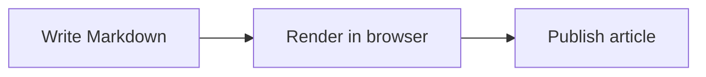

# Markdown Rendering Guide

The blog uses a lightweight subset of the rendering experience from Markdown
Preview Enhanced. All rendering happens in the visitor's browser. Article text
is not sent to a diagram, code-execution, or third-party rendering service.

## Supported Markdown

- GitHub Flavored Markdown: tables, task lists, strikethrough, and footnotes.
- KaTeX math: `$E=mc^2$` for inline math and `$$ ... $$` for display math. A closing `$$` glued onto the formula line (`$$\nformula$$`) is moved onto its own line before parsing, so the rest of the article is not swallowed as a KaTeX error.
- Fenced code blocks with syntax highlighting and a copy button.
- Mermaid diagrams in fenced `mermaid` blocks. Mermaid is loaded only for an
  article that contains a Mermaid block.
- GitHub alerts: `> [!NOTE]`, `TIP`, `IMPORTANT`, `WARNING`, and `CAUTION`.
- Safe rich text: `details`, `summary`, `kbd`, `mark`, `sub`, `sup`, `ins`,
  and `del`. Other raw HTML remains escaped.
- Heading anchors, a hierarchical table of contents, responsive tables, and
  responsive images with captions.

## Mermaid Example

Use the normal Markdown fenced-code syntax:

```text

```

The rendered SVG is sandboxed by Mermaid's strict security mode. Do not put
untrusted links or sensitive data into a diagram. If the syntax is invalid,
the page shows the original diagram source instead of failing the whole article.

## Performance and Compatibility

- Mermaid does not add a request to ordinary Markdown articles.
- Diagrams, images, fonts, and code highlighting notify the article layout so
  the table of contents can recalculate heading positions after content size
  changes.
- Large or complex diagrams can still take noticeable time on low-end phones.
  Prefer concise flowcharts and split very large diagrams into separate
  sections.
- PlantUML, Pandoc export, executable code chunks, and editor-only features
  from the desktop extension are intentionally not included. They need server
  programs, external services, or create an unnecessary security risk on a
  shared PHP host.
